# New Features and Cloud Voice OTP Plan

Date: 2026-11-06
Source: `new_feature_design.txt`

## Scope and Status

| Design item | Delivery |
| --- | --- |
| 1. Three welcome SMS | Implemented: narrowly matched incoming template, ICCID verification, protected number/operator persistence, opt-in SIM sync. |
| 2. WorldCode | Implemented: seller and public price endpoints, separate credential, VGB country, preserved compatibility routes and isolated legacy retries. |
| 4. Online voice recognition | Cloud remains PLAN ONLY. The separately approved local COM2 trial below implements the interactive flow using bundled Whisper. |

The welcome-SMS control is in Phone Number Management and defaults off. It processes newly read incoming SMS after successful storage. The sample produces operator `Three`, stored number `7848998171`, and physical-SIM commands `AT$QCPBMPREF=1`, `AT+CPBS="ON"`, `AT+CPBW=1,"+7848998171",145`. This follows the requested national-number convention; it does not invent an international country prefix. Manual or conflicting numbers are not overwritten. Confirmed eSIM hardware remains DB-only; unknown hardware never receives a phonebook write. Ordinary manual eSIM/Multi-SIM phone editing remains DB-only.

WorldCode seller traffic uses `https://www.worldcode.win/ksapi.ashx`; the public price catalog uses `https://www.worldcode.win/yhapi.ashx?act=getItem&key=`. `key` on the public catalog is a search keyword, not a seller credential. The new `worldcode_api_key` must be entered locally in the WorldCode page. An existing Firefox key is not copied or sent to WorldCode. Existing `/api/firefox/*` endpoints and database names remain compatibility identifiers, not destinations. Old Firefox retries remain stored but are ineligible for WorldCode delivery. Public catalog HTTPS was verified without credentials. A seller-authenticated upload still requires the user's WorldCode key and explicit test approval.

## Approved Local-First COM2 Trial

The user approved local Whisper testing before obtaining an OpenAI key. The
Calls view now has an opt-in, single-port interactive flow with independent
prompt/code durations, language, code length, deadline, stage progress,
transcripts, recording downloads and cancellation. The default settings are
COM2, 10 seconds per stage, six digits, automatic language, and 120 seconds.
Settings default disabled; only an explicitly armed port uses the new flow.

The user's binaries are `tools/lpac/lpac.exe` and
`tools/whisper/whisper-cli.exe`, with `tools/whisper/ggml-base.bin`. Portable
ffmpeg is under `tools/ffmpeg/ffmpeg.exe`. Obsolete speech-tool paths fall back
to these bundled paths. The implementation uses one Whisper worker and one
interactive trial at a time, verifies call ownership, starts recording before
DTMF, rejects ambiguous instructions, and does not replay jobs after restart.

Hardware-free state-machine and persistence tests plus generated-speech local
Whisper recognition have passed. Actual in-call QFDWL/record restart/DTMF and
IVR timing remain the user's approved COM2 hardware gate. No outgoing test call,
SIM-slot switch, cloud request, OTP forwarding, or OpenAI integration is part of
this local-first implementation. Existing saved numbers remain protected.

## What You Need to Do

1. Sign in or create an account at https://platform.openai.com/ and create a dedicated API project.
2. Set up API billing separately. A ChatGPT subscription does not, by itself, pay for API calls. Set an appropriate project spending limit and alerts; confirm whether hard enforcement is available/enabled rather than assuming an alert stops spending.
3. Create a restricted project API key with access to audio transcription. Enter it directly into a local secret store, preferably Windows Credential Manager, or the backend's `OPENAI_API_KEY` environment variable. Do not paste it into this chat, frontend code, source control, screenshots, logs, or a shared config file.
4. Confirm the project's available transcription model, rate limits, internet access to `api.openai.com`, and budget. The current guide recommends `gpt-transcribe`; make the model configurable and test project availability before enabling. Do not build a new dependency on the older transcription aliases marked for shutdown in the current documentation.
5. Approve a controlled test using your own SIM/account and recordings you are authorized to process. Confirm language, expected OTP length, enabled ports, and whether automatic answer/DTMF is permitted. Retain the existing restriction on manual RF tests: COM1 slots 1 and 2 only, unless you explicitly change it.
6. Approve implementation after reviewing this plan. No API key or paid request is needed to review it.

## Verified Starting Point

- `src/transcribe.rs::transcribe` runs local ffmpeg and whisper.cpp; it is not a local ChatGPT server. Reuse its AMR-to-WAV conversion, with bounded concurrency, without requiring a local Whisper model for cloud mode.
- `src/modem/manager.rs::run_urc_handler` answers calls, starts `a.amr`, enforces a fixed 30-second timer, and downloads/transcribes after call end. That path cannot perform the requested first recognition while the call remains active.
- `src/modem/core.rs` has `start_recording`, `stop_recording`, and `download_file` using `AT+QAUDRD` and `AT+QFDWL`. It has no DTMF sender today. Binary downloads now share the serial response ownership lock so they cannot interrupt the welcome-SMS transaction. Per-call ownership, cancellation and live-call timing still need review before reusing downloads during a live IVR workflow.
- The backend is Rust/Tokio/Axum with authenticated APIs, SQLite call records, SSE call events, and existing recording/transcript display. Extend these surfaces rather than adding a second application.

## Requirements

| ID | Requirement |
| --- | --- |
| REQ-001 | Select local or OpenAI transcription without requiring local Whisper for cloud mode; keep existing local behavior available. |
| REQ-002 | Answer only explicitly enabled calls/ports, record stage 1 for an independently configurable duration, and keep the call connected. |
| REQ-003 | Download/convert stage 1 and transcribe it before the live call's deadline. |
| REQ-004 | Extract one explicit DTMF instruction and send only the allowed digit, exactly once for that call. |
| REQ-005 | Capture stage 2 without clipping its beginning, stop recording, hang up, download, transcribe, and extract the OTP. |
| REQ-006 | Configure both recording windows, language/model, OTP length, timeouts, admission limits and concurrency; scale safely toward 32+ ports. |
| REQ-007 | Persist both stages and operation status; expose progress, cancellation, failures and the final transcript/OTP through existing authenticated UI/API patterns. |
| REQ-008 | Protect keys/recordings/OTP privacy, bound cost, and clean up on failure, hangup, unplug and restart. |
| REQ-009 | Prove modem support and latency on an approved single-port test before claiming the interactive workflow or 32-port capacity. |

## Design and Decisions

### P1. Hardware and Deadline Gate

First verify on an approved device that stopping/reading an AMR file does not disconnect the call, that the modem accepts DTMF during that call, and that recording can be restarted immediately. `AT+VTS="5"` is a candidate only after checking the actual modem's command support; do not assume syntax/support from a different modem.

Measure recording completion, download, conversion, API queue/response time, IVR expiry, and second-stage start. If in-call download is unsupported or the IVR expires before recognition, stop and report that the file-based design cannot work on that firmware. Then evaluate a modem-supported audio stream or approved external audio interface; do not claim a Realtime API can create a hardware audio stream that is not available.

### P2. Cloud Transcription Provider

Backend-only multipart `POST https://api.openai.com/v1/audio/transcriptions`, `Authorization: Bearer` from the local secret store, model `gpt-transcribe` if available, JSON `text` response. Use that model's documented `languages` field, not a legacy singular `language` parameter. Keep provider-specific parameters separate if another model is selected later.

AMR is not a listed direct upload format in the current guide. Convert with ffmpeg to mono 16 kHz PCM WAV, reuse bounded temporary-file handling, and reject empty/truncated/oversized files. The documented upload limit is 25 MB; impose a smaller application limit appropriate to short OTP calls. Use timeouts, cancellation and redacted errors; no second text-LLM request is necessary to parse digits. No cloud-to-local fallback unless explicitly configured: fallback can be too slow to meet the live IVR deadline.

### P3. Call State Machine

```mermaid
stateDiagram-v2
    [*] --> Admitted
    Admitted --> Answered
    Answered --> RecordingPrompt
    RecordingPrompt --> DownloadingPrompt
    DownloadingPrompt --> TranscribingPrompt
    TranscribingPrompt --> PreparingOtpRecording: one valid press instruction
    TranscribingPrompt --> HangingUpDirect: one unambiguous direct OTP, no DTMF
    HangingUpDirect --> Done
    PreparingOtpRecording --> SendingDtmf: recording confirmed active
    SendingDtmf --> RecordingOtp
    RecordingOtp --> HangingUp
    RecordingOtp --> DownloadingOtp: remote call ended; finalize owned recording
    HangingUp --> DownloadingOtp
    DownloadingOtp --> TranscribingOtp
    TranscribingOtp --> Done: one valid OTP
    TranscribingPrompt --> Failed: unclear or deadline exceeded
    TranscribingOtp --> Failed: unclear or malformed
    Failed --> Cleanup
    Done --> Cleanup
    Cleanup --> [*]
```

Use a call ID plus connection identity, not COM alone, as ownership. Handle URCs without blocking their receive loop on HTTP. Recheck that the same call is active before every modem mutation. Start stage-2 recording before DTMF so immediate OTP speech is not lost. Replace/suppress the old 30-second recording timer only for opted-in interactive jobs. Manual hangup, remote hangup, cancellation and unplug converge on idempotent cleanup; a restarted application marks interrupted jobs rather than replaying DTMF or answering a different call.

Parse only an explicit instruction such as `press five` or `press 5`; require one distinct unambiguous digit. The local IVR trial now records both repetitions, transcribes the full prompt once, and compares each recognized instruction. At least two complete readings must match; quoted digits are accepted, conflicting choices and multi-digit commands are rejected. Incomplete/unclear readings keep the call connected for review until remote end, user cancellation, or deadline rather than hanging up immediately. Send the agreed digit only once, with `*`/`#` disabled unless specifically approved. Preserve OTPs as strings, including leading zeroes, and support digit words plus spaced digits. Do not merge unrelated digit groups or let a language model invent missing digits. OTP length is configurable: the requested `58861` is five digits, and must not imply all WhatsApp codes have that length.

If the first recording already contains one unambiguous OTP and no press instruction, save that result and hang up the owned call without DTMF or a second recording. If there is neither a clear instruction nor a clear OTP, stop safely with a reviewable failure; do not guess a digit. A partial/silent prompt is not evidence that the default digit should be 5.

### P4. Concurrency and Cost

Proposed starting defaults: prompt 10 seconds, OTP 10 seconds, independent validated range 3-30 seconds; two ffmpeg workers; four simultaneous HTTP requests; bounded admission and an overall call deadline measured in P1. These are tuning defaults, not certified capacity. Prioritize stage-1 jobs by deadline so completed stage-2 transcription cannot starve calls waiting for DTMF. A full admission queue must not silently auto-answer calls it cannot service in time.

Thirty-two calls with two 10-second clips mean 64 transcription requests and approximately 10.67 minutes of audio, excluding retries. Check current model prices and actual account limits before setting a concurrency target. Apply bounded backoff/Retry-After for 429 and transient errors only while the call deadline permits. Never retry a DTMF side effect. Record queue depth, latency, request count and outcomes without recording credentials or unmasked OTPs in logs.

### P5. Persistence, UI and Privacy

Extend the existing calls model with provider/model, two stage states/transcripts, validated DTMF/OTP, recording references, timestamps and redacted failure reason. Preserve existing recordings/transcripts and schema history. Keep completed recordings under the existing authenticated access policy; default retention should be short and configurable, with optional deletion after successful recognition. Do not forward OTPs to WorldCode, webhooks or other services without a separate explicit opt-in.

Use existing call views for stage progress, distinct local/cloud selection, per-port arming, two duration inputs, retry-transcription-only and cancel/hangup. Store/expose only whether an API key is configured; never return it to the browser. Review recording consent, authorized account ownership and provider retention/data terms before enabling cloud transmission.

## Implementation Tasks

The tasks below describe the full cloud-capable delivery. The approved local
trial above implements a subset of the shared workflow; cloud/provider work,
the actual one-port hardware gate, and capacity certification remain pending.

- [ ] T001 [Plan:P1] Verify recording/download/DTMF compatibility and latency on approved hardware; record results against `src/modem/core.rs` recording/download methods before implementing automation. Covers REQ-003, REQ-009.
- [ ] T002 [Plan:P2] Add a local/OpenAI provider configuration and backend secret lookup in `src/config.rs`, `src/transcribe.rs`, `config.toml.example`, and `Cargo.toml` if multipart support is missing. Covers REQ-001, REQ-006, REQ-008.
- [ ] T003 [Plan:P2,P4] Implement bounded conversion/HTTP workers, documented multipart request/response, deadlines, redaction and cancellation in `src/transcribe.rs`; cover them with offline HTTP fixtures. Covers REQ-001, REQ-003, REQ-006, REQ-008.
- [ ] T004 [Plan:P3] Add validated DTMF and safe per-call recording/download ownership in `src/modem/core.rs`; mock the command order, duplicate prevention and changed-call rejection. Covers REQ-002, REQ-004, REQ-005, REQ-008.
- [ ] T005 [Plan:P3,P4] Implement the per-call state machine and strict transcript parsers next to `src/modem/manager.rs::run_urc_handler`, retaining ordinary-call behavior and cancelling the correct recording timer. Covers REQ-002 through REQ-006, REQ-008.
- [ ] T006 [Plan:P5] Add the next calls migration and helpers in `src/db.rs`, stage events in `src/api/sse_manager.rs`, and authenticated status/cancel handling alongside the existing call routes in `src/api/mod.rs`. Covers REQ-007, REQ-008.
- [ ] T007 [Plan:P5] Extend existing call controls/views and `frontend/src/js/api.js`/`frontend/src/js/i18n.js` for provider, arming, durations, stages and transcript/OTP results. Covers REQ-001, REQ-006, REQ-007.
- [ ] T008 [Plan:P1,P3,P4,P5] Verify digit-word/leading-zero/ambiguous and direct-OTP/no-prompt examples, early remote hangup, missing files, API 401/429/timeouts, disconnect/restart, user cancellation and serial command exclusion; then run the approved real one-port trial and a mocked 32-port load test. Covers REQ-002 through REQ-009.
- [ ] T009 [Plan:P1,P4] After the one-port trial passes, measure larger approved deployments and document supported concurrency, latency and budget. Do not claim real 32-port validation from a mock alone. Covers REQ-006, REQ-009.

## Requirement Mapping

| Requirement | Plan Items | Implementation Evidence When Approved |
| --- | --- | --- |
| REQ-001 | P2, P5 | T002, T003, T007: provider selection and both provider paths |
| REQ-002 | P3 | T004, T005, T008: admitted call, active recording and independent timer |
| REQ-003 | P1, P2, P3 | T001, T003, T005, T008: live-call download and bounded transcript |
| REQ-004 | P3 | T004, T005, T008: one explicit DTMF command exactly once |
| REQ-005 | P3 | T004, T005, T008: recording-before-DTMF and final OTP |
| REQ-006 | P4, P5 | T002, T003, T005, T007, T008, T009: configuration and load evidence |
| REQ-007 | P5 | T006, T007, T008: persisted stages and authenticated UI/events |
| REQ-008 | P2, P3, P4, P5 | T002 through T006, T008: secret safety, timeouts and cleanup |
| REQ-009 | P1, P4 | T001, T008, T009: actual modem evidence and measured capacity |

## References

- `doc/WorldCode-API_kashang.pdf`: seller endpoint, payloads, limits and VGB mapping.
- `doc/WorldCode-API_user.pdf`, pages 11-12: public `getItem` catalog.
- https://developers.openai.com/api/docs/guides/speech-to-text: file transcription, current model, format and parameter guidance (checked 2026-11-06).
- https://help.openai.com/en/articles/8156019-how-can-i-move-my-chatgpt-subscription-to-the-api: separate API billing.
- https://help.openai.com/en/articles/5112595-best-practices-for-api-key-safety: backend-only secret storage and key safety.